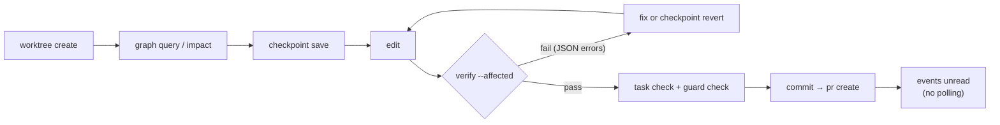

<div align="center">

# ⚡ MonoFlow

### Make your monorepo usable by coding agents.

One Go binary that gives Claude Code, Cursor, Antigravity and Copilot a **map** of your repo,<br>
a **fast feedback loop**, an **undo** button, an **isolated place** to work, and a **safe path** to ship.

[](https://github.com/M0xoo/monoflow/actions/workflows/ci.yml)
[](https://go.dev)
[](./LICENSE)
[](#2--feedback-in-seconds-as-json)
[](#-language-support)

[**Website**](https://m0xoo.github.io/monoflow/) •
[Quickstart](#-quickstart) •
[What you get](#-what-you-get) •
[The agent loop](#-the-agent-loop) •
[Commands](#-commands)

</div>

---

## 💡 Why MonoFlow?

Most monorepos are set up for humans. When an autonomous agent does the coding, the same workflow wastes its time, its tokens and your review hours.

| 🐢 Without MonoFlow, an agent… | ⚡ With MonoFlow, it… |
| :--- | :--- |
| greps the whole tree to guess what depends on what | asks the dependency graph directly: `graph query`, `graph impact` |
| runs the full suite and reads pages of colored logs | checks **only affected packages** and gets errors back as **JSON** |
| commits every failed attempt, or loses work it can't undo | **checkpoints and reverts** in milliseconds, with nothing in Git history |
| edits the same checkout as you and every other agent | works in its own **sparse worktree** |
| "fixes" red tests by deleting assertions | gets stopped by the **test integrity guard** |
| polls `gh run watch` in a loop, spending tokens while it waits | pushes, moves on, and is **notified** when CI finishes |

---

## 🚀 Quickstart

```bash
# 1. Build (Go 1.22+)
git clone https://github.com/M0xoo/monoflow.git
cd monoflow && make build

# 2. Install into your repository
cd /path/to/your-repo
/path/to/monoflow/install.sh

# 3. (optional) Add GitHub Actions caching + two-tier CI
.agents/bin/monoflow init --setup-gh-actions
```

`monoflow init` discovers your packages and writes everything your agent needs:

| File | Purpose |
| :--- | :--- |
| `.agents/monoflow.config.json` | Discovered packages and dependency graph |
| `AGENTS.md` · `.agents/rules/` · `.agents/skills/monoflow/` | Instructions your agent loads automatically |
| `.agents/task.json` | Task boundaries (`allowed_paths`, `read_only_paths`) |
| `.agents/quarantine.json` | Flaky tests kept out of the feedback loop |

---

## 🧰 What you get

### 1. 🗺️ A map of the repo, so agents don't have to crawl it

`init` finds your packages and their dependency graph. After that, agents ask questions directly:

```bash
monoflow graph query packages/core        # upstream deps + downstream dependents
monoflow graph impact packages/core/x.go  # which packages a change to this file affects
```

Large repo? `monoflow clone --packages=billing` and `monoflow subset set` check out only the packages a task needs, plus whatever they depend on.

### 2. ⚡ Feedback in seconds, as JSON

`monoflow verify --affected` checks only the packages your change touches. It runs them in parallel and uses cached results when inputs haven't changed. Compiler and test errors come back normalized, with no ANSI codes and no spinners:

```json
{
  "status": "failed",
  "affected_packages": ["packages/core"],
  "results": [{
    "target": "packages/core",
    "language": "go",
    "errors": [{
      "file": "./core.go", "line": 3, "col": 25, "code": "go-error",
      "message": "cannot use \"x\" (untyped string constant) as int value in return statement"
    }],
    "command_run": "go build ./..."
  }]
}
```

### 3. ⏪ Undo without touching Git history

Agents learn by trying things. Checkpoints let them do that without making a commit for every attempt:

```bash
monoflow checkpoint save "try new tax rounding"
# ...edit, verify, fail...
monoflow checkpoint revert
```

Snapshots use Git plumbing (`write-tree` / `read-tree`), so they never show up in the log.

### 4. 🧪 An isolated worktree for every agent

Several agents (or an agent and a human) can share one repo without getting in each other's way. Each one works in its own sparse worktree, which contains only the packages it needs:

```bash
monoflow worktree create agent-42 --packages=billing
monoflow worktree sync --to=agent-42 --from=agent-7   # symbol-level merge
monoflow worktree finish agent-42
```

When two agents add different functions to the same file, MonoFlow merges at the **AST level** (Go, TS/JS, Python), so you don't get conflict markers.

### 5. 🛡️ Guardrails you can trust

| Guardrail | Command | What it stops |
| :--- | :--- | :--- |
| **Task boundaries** | `task check` | Edits outside `allowed_paths`, or to `read_only_paths` |
| **Test integrity** | `guard check` | Deleted, commented-out or hollow assertions |
| **Secret scan** | `guard check` | API keys and private keys in diffs |
| **Proof of work** | `task prove <id>` → `verify --proof=<id>` | "It works on my machine" PRs |
| **Risk scoring** | `review risk` · `review audit` | Risky changes without a human; PR descriptions that don't match the diff |
| **Backpressure** | `review throttle` | Agents opening more PRs than reviewers can handle |

### 6. 🚢 A shipping path built for agents

- **Commits and branches without raw Git.** `commit`, `branch`, `sync` and `push` keep sparse checkouts intact and **refuse direct pushes to `main`**.
- **PRs.** `pr create | test | local | review | merge` opens PRs with a risk tier, a proof receipt and the list of affected packages.
- **No CI polling.** `push` starts a background watcher and returns right away. When CI finishes, the result lands in `.agents/events/`, and the agent reads it with `events unread`.
- **Two-tier CI.** `queue spec` runs a speculative local merge and signs a receipt. `ci check` lets CI take a fast path for verified commits.
- **Caching and releases.** A content-addressed package cache with an optional HTTP server (`cache serve`), plus SemVer changesets that cascade through dependents (`version bump --cascade`).

---

## 🔁 The agent loop

`init` writes this loop into `AGENTS.md`, so your agent follows it without extra prompting:



---

## 🌐 Language support

| Language | Fast checks | Diagnostics |
| :--- | :--- | :--- |
| **Go** | `go build`, `go vet`, `go test -run` | file / line / col and package failures |
| **TypeScript / Node** | `tsc --incremental`, `biome`, `vitest` | TS error codes, expected / received |
| **Rust** | `cargo check -p`, `cargo test -p` | borrow and type errors, without full codegen |
| **Python** | `ruff check`, `pytest` | Ruff codes, Mypy errors, assertion failures |
| **Protobuf** | `buf` schema checks | dependency impact across languages |

---

## 📖 Commands

| Area | Commands |
| :--- | :--- |
| 🏁 **Setup** | `init [--setup-gh-actions]` · `clone <url> --packages=…` |
| 🗺️ **Understand** | `graph` · `graph query <pkg>` · `graph impact <file>` |
| ✂️ **Partial checkout** | `subset set\|add\|remove\|update\|deps\|list\|check\|reset` |
| ⚡ **Inner loop** | `verify --affected` · `checkpoint save\|revert\|list` · `cache status\|clean\|serve` · `quarantine list\|add` |
| 🧪 **Isolation** | `worktree create\|focus\|add\|remove\|update\|isolate\|sync\|list\|finish\|gc` |
| 🛡️ **Guardrails** | `task check\|prove\|slice` · `verify --proof=<id>` · `guard check` · `review risk\|audit\|throttle` |
| 🌿 **Git** | `commit -m` · `branch` · `sync` · `push` |
| 🚢 **Ship** | `pr create\|list\|view\|test\|local\|review\|merge` · `queue spec` · `ci check` · `outer start\|status\|wait` |
| 📬 **Events** | `events unread\|list\|ack\|clear` |
| 📦 **Build & release** | `deliver` · `app test` · `version list\|bump\|apply\|check` |
| 🎬 **Try it** | `scenario run [--json]`: a full multi-agent simulation on a temporary repo |

Run `monoflow` with no arguments to see the full usage.

---

## 🤝 Contributing

Contributions are welcome!

```bash
make test    # unit + integration tests
make build   # bin/monoflow
make e2e     # end-to-end multi-agent scenario
```

---

## 📄 License

Licensed under the [MIT License](./LICENSE).
