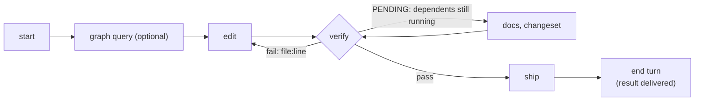
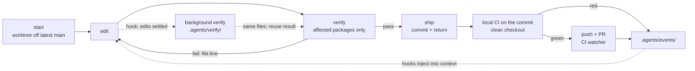

<div align="center">

# ⚡ MonoFlow

### Make your monorepo usable by coding agents.

One Go binary that gives Claude Code, Cursor, opencode and other agents a **map** of your repo,<br>
**feedback that covers exactly what CI covers**, an **isolated place** to work, and a **safe path** to ship.

[](https://github.com/M0xoo/monoflow/actions/workflows/ci.yml)
[](https://go.dev)
[](./LICENSE)
[](#-language-support)

[**Website**](https://m0xoo.github.io/monoflow/) •
[Quickstart](#-quickstart) •
[The agent path](#-the-agent-path) •
[What you get](#-what-you-get) •
[How it works](#-how-it-works) •
[Benchmarks](#-benchmarks) •
[Commands](#-commands)

</div>

---

## 💡 Why MonoFlow?

Most monorepos are set up for humans. When an agent does the coding, the usual workflow wastes its time, its tokens and your review hours.

| 🐢 Without MonoFlow, an agent… | ⚡ With MonoFlow, it… |
| :--- | :--- |
| greps the whole tree to guess what uses a package | asks `graph query <dir>`: every importer, in every module |
| guesses which tests to run, or runs everything | runs `verify`: every package the change can affect, nothing else |
| reads pages of colored logs | gets each break as `file:line`, with the failing line shown |
| pushes, then finds out CI is red | can only push a commit that passed local CI on that exact commit |
| polls `gh run watch`, spending tokens while it waits | ends its turn; results are **delivered** to it |
| edits the same checkout as you and every other agent | works in its own worktree and branch |

---

## 🚀 Quickstart

```bash
# 1. Build (Go 1.22+)
git clone https://github.com/M0xoo/monoflow.git
cd monoflow && make build

# 2. Install into your repository
cd /path/to/your-repo
/path/to/monoflow/install.sh

# 3. (optional) GitHub Actions: affected-only CI that reuses local results
./bin/monoflow init --setup-gh-actions
```

`monoflow init` discovers your packages (Go modules, pnpm/npm/yarn workspaces with Nx or Turborepo, Cargo, Python, plus `packages/`, `apps/`, `services/`… directories) and writes what your agent needs:

| File | Purpose |
| :--- | :--- |
| `.agents/monoflow.config.json` | Packages, their commands and the dependency graph |
| `AGENTS.md` · `CLAUDE.md` · `.agents/skills/monoflow/` | A 1.4 KB guide, placed first in both `AGENTS.md` and `CLAUDE.md` (Claude Code reads the latter); your own instructions follow it |
| `.claude/settings.json` · `.opencode/plugin/` | Hooks that deliver results to the agent and redirect raw commands |
| `.agents/task.json` · `.agents/quarantine.json` | Task boundaries; flaky tests kept out of the loop |

---

## 🔁 The agent path

Three commands take a change to a PR:

```bash
monoflow start fix-tax-rounding     # worktree + branch agent/fix-tax-rounding; cd into the printed path
monoflow find "roundTax"            # every occurrence, grouped code / tests / docs (instead of grep -rn)
# ... edit ...
monoflow verify                     # your packages' failures in seconds; every dependent checked behind them
monoflow ship -m "fix: tax rounding" # commit, local CI on that commit, push, open the PR
```



Output is short plain text, because an agent reads it rather than parsing it. Every command takes `--json` (or `MONOFLOW_FORMAT=json`) for scripts. A failing `verify`:

```
FAIL 0/1 packages passed in 1.0s
scope: all 1 packages (every package depends on your change)
failed: core
core/core_test.go:7 [TestAdd] want 3
       6| 	if Add(1, 2) != 3 {
  >    7| 		t.Fatal("want 3")
       8| 	}
next: fix the errors listed (file:line), then monoflow verify
```

---

## 🧰 What you get

### 1. 🗺️ A map of the repo

```bash
monoflow find "BAD_REQUEST"               # occurrences: source lines with text; tests, docs, examples as file:lines
monoflow graph query packages/core        # dependencies, dependents, and (Go) every package importing it
monoflow graph impact packages/core/x.go  # which packages a change to this file affects
```

`find` leaves out changelogs, build output and generated reference docs. On trpc, `find BAD_REQUEST` prints 5 KB where `grep -rn` prints 23 KB, and grep dumps were the largest token cost in agent runs with and without MonoFlow.

`graph query` works on a package name or any directory inside one. For Go it lists the importing packages across all modules in about a second, which agents otherwise approximate with a repo-wide grep.

### 2. ⚡ `verify`: the CI for this change, locally

- **Scope.** The changed packages and everything that depends on them, which is what CI runs for this change. The output says how many packages were left out and why. For Go, only the packages whose code or tests import a changed package are run, and gofmt checks only the changed files.
- **Answers in seconds.** The changed packages are checked first, and `verify` returns as soon as they fail: on TanStack Query, 12 s instead of 93 s for the whole graph. Their dependents are checked in the background meanwhile, and the next `verify` includes them, from cache. When the changed packages pass and the dependents are still running, it says `PENDING` (not a pass) so the agent finishes docs and changesets in the meantime. No call blocks past the 2-minute tool limit of agent harnesses.
- **Re-runs only what your edits touched.** Per test file for vitest: a re-verify runs only the test files you edited and the ones that failed, as long as the package's other files and its upstream packages are unchanged (trpc: 34 s instead of 66 s). Vitest isolates test files, so these per-file passes add up to the full suite, and local CI reuses them. Each check (typecheck, lint, test) is cached on its own, so a failing test does not re-run a passing typecheck.
- **Every failure, grouped by file.** All of them, one line each, the first few with their diff and source line; no "... 39 more errors" that sends an agent back for the rest. Matcher boilerplate (Testing Library's DOM dumps) is stripped.
- **Uses your repo's own tools.** It runs your package scripts (`test`, `test:lib`, `typecheck`, `lint`…). Upstream builds go through Nx or Turborepo in one call when the repo uses them, while the changed packages are being checked.
- **The agent's loop checks what it changed fully, its dependents by their tests.** Typecheck, lint and tests for the changed packages; only the tests of the packages that depend on them. Their typecheck and lint run in local CI on the exact commit before anything is pushed, so nothing unchecked reaches the remote (a type error there arrives as `SHIP_FAILED`). On TanStack Query the full in-loop check went from 114 s to 77 s.
- **Slowest first.** Packages start in order of their last run time, so the run is not held up by a long suite started last.
- **Cached** by content. A package whose inputs didn't change is not re-run.
- **Pre-existing failures** (already red on the base branch) are reported but don't block. `--strict` makes them block.
- **Flaky tests.** Failed test files are re-run once alone; a failure that does not happen again is reported as flaky, not blocking.
- **Runs in the background.** In a worktree from `start`, `verify` starts as soon as the agent's edits settle. When the agent asks, the result for those exact files is often already there.
- **Snapshots.** `verify -u` rewrites mismatched vitest/jest snapshots when the new values are intended, re-running only the test files that can mismatch.
- **Formatting is done for you.** Before checking, `verify` (and `ship`, before committing) runs each package's `fix_cmd` on the files the agent changed and lists what it formatted. A reformatted file keeps its cache keys for tests and type checks, so formatting never throws away a background run. `init` picks the repo's own formatter: prettier, biome, oxfmt or dprint for JS (from the root `format` script or config), gofmt for Go, ruff for Python, cargo fmt for Rust.

Every package's commands live in `.agents/monoflow.config.json` and can be changed per package: `test_cmd`, `typecheck_cmd`, `lint_cmd`, `fix_cmd` (`{files}` or `{files:.go}` stands for the changed files; `"none"` turns it off) and `prepare_cmd`. Re-running `init` keeps what you set.

### 3. 🚢 `ship`: nothing red reaches the remote

`ship` commits and returns right away. In the background, MonoFlow runs local CI on that exact commit, in a clean checkout of it. Only when that is green does it push and open the PR. If it fails, the agent gets `SHIP_FAILED` or `OUTER_LOOP_REGRESSION` with the errors.

- Direct pushes to `main`/`master` are refused, and raw `git push`/`git commit` are redirected through MonoFlow by Git hooks and harness hooks.
- Forgot `start` and edited on `main`? `ship` moves the work onto its own branch and worktree first.
- With `init --setup-gh-actions`, remote CI runs only affected packages. It can take a fast path for commits that carry a local proof receipt.

### 4. 📬 No polling

MonoFlow's hooks for Claude Code and opencode inject new events (local CI, remote CI, PRs) into the agent's context after its tool calls. When the agent ends its turn while a result is pending, the Stop hook waits for it and resumes the agent if something needs action. Other harnesses can run `monoflow events wait <sha>` as a background task.

When CI is red, `monoflow ci health` reports when each check started failing, the breaking commit range and flaky checks, in one call instead of dozens of `gh run view` reads.

### 5. 🧪 Isolation and undo

```bash
monoflow start agent-42 --packages=billing   # sparse worktree: billing + what it depends on
monoflow checkpoint save "try new rounding"  # snapshot outside Git history
monoflow checkpoint revert
monoflow worktree finish agent-42
```

Full (non-sparse) worktrees for pnpm repos get a real offline `pnpm install`, so test runners like Vite see real paths. When two agents add different functions to the same file, `worktree sync` merges them: at the AST level for Go, and by import lines and appended blocks for TS/JS and Python.

### 6. 🛡️ Guardrails

| Guardrail | Command | What it stops |
| :--- | :--- | :--- |
| **Test integrity** | `guard check` (also on `commit`) | Deleted, commented-out or hollow assertions |
| **Secret scan** | `guard check` (also on `commit`) | API keys and private keys in diffs |
| **Task boundaries** | `task check` | Edits outside `allowed_paths`, or to `read_only_paths` |
| **Proof of work** | `task prove <id>` → `verify --proof=<id>` | "It works on my machine" PRs |
| **Risk scoring** | `review risk` · `review audit` | Risky changes without a human; PR text that doesn't match the diff |
| **Backpressure** | `review throttle` | More PRs than reviewers can handle |
| **Circuit breaker** | automatic in `verify` | An agent failing the same targets over and over (snapshots its work) |

### 7. 📦 Package versions: live code or a pinned release

Each in-repo dependency is one of two kinds of edge, and each consumer picks (`monoflow version edges` lists them all):

| Edge | The consumer's manifest points at | A change to the dependency |
| :--- | :--- | :--- |
| **source** (default) | the package's directory (`workspace:`, Go `replace`/`go.work`, Cargo/uv path) | affects the consumer at once: `verify` re-tests it, and an API break is fixed in the same change |
| **pinned** | a release snapshot under `.agents/releases/<pkg>@<version>/` | does not affect it; the consumer upgrades when it chooses |

Releasing and consuming a package:

```bash
monoflow version suggest money                # required bump from the exported-API diff (removed/changed = major)
monoflow version bump money minor             # writes the version; reports each consumer's impact, rewrites none
monoflow version release money                # tags money@1.3.0 and notifies the consumers that pin it
monoflow version pin ledger money             # ledger builds against money@1.3.0, isolated from later changes
monoflow version upgrades ledger              # newer releases, with the API changes ledger actually uses
monoflow version upgrade ledger money         # moves the pin and runs ledger's own checks
```

- **Releases are git tags** (`<pkg>@<version>`); releasing a version twice, or a package with uncommitted changes, is refused.
- **Pins are committed snapshots** of the release (and the in-repo code it was built with), so any clone, IDE or CI builds them without MonoFlow. Snapshots nobody pins any more are removed, and `version check` flags one that no longer matches its tag.
- **Consumers are told**: a release sends each pinning consumer a `DEPENDENCY_RELEASED` event saying whether it is compatible or breaking for that consumer and which of its uses change. A source consumer already builds against the live code, so the note is informational.
- **Many agents, one release**: agents record the bump a change needs as a changeset (`task changeset`); `version apply` applies the highest bump per package.
- Pinned edges are left out of the graph `verify` and the cache use, so editing `money` does not re-test a consumer pinned to an older release.

---

## ⚙️ How it works

MonoFlow doesn't replace your compilers, test runners or CI. It's a layer between the agent and Git that decides **what** to run, **where** to run it, and **how the agent hears about the result**. Everything it knows lives in plain files under `.agents/`.



### The graph
`init` finds packages from what's already in the repo: `go.mod`/`go.work`, pnpm/npm/yarn workspaces (using Nx or Turborepo when present), Cargo crates, `pyproject.toml`/`setup.py`, and a `contracts/` directory. It reads each package's dependencies from its manifest and stores packages, edges and commands in `.agents/monoflow.config.json`.

A changed file belongs to the package with the longest matching path prefix. The **affected set** is those packages plus everything that depends on them, transitively. Repo-wide files (lockfiles, `go.work`, root `tsconfig`, `turbo.json`/`nx.json`, CI workflows) mark every package as affected. For Go, `graph query` runs `go list` in every module in parallel to find the packages that actually import the target, so an agent doesn't have to grep for it.

### The worktree
`start <id>` fetches the base branch and runs `git worktree add -b agent/<id>` from `origin/<base>`, so local commits that origin does not have never ride along (`--from-local` starts from your local base instead). That puts every agent on its own branch, in its own directory, starting from the latest main.
* **Shared state:** caches, proofs and events are symlinked to the root checkout, so every worktree sees the same results.
* **Copied in:** config, `.env*` files and the binary are copied so the agent starts with a working setup.
* **Dependencies:** pnpm repos get a background `pnpm install --offline`. Otherwise the root's `node_modules` is linked, or copy-on-write cloned with `--isolated-deps`.
* **Sparse mode:** `--packages=` narrows the checkout to those packages and what they depend on. It uses Git's sparse cone and trims `go.work` to match.
* **Bookkeeping:** worktrees are recorded in a locked registry. `worktree gc` removes stale ones but never a worktree with uncommitted or unpushed work.

### verify
1. **What changed:** uncommitted paths from `git status`. On a clean tree, it uses the branch's diff against `origin/main`.
2. **Scope:** the changed packages run first, in parallel, while the dependents' upstream builds run. The agent's `verify` answers with their failures at once (or `PENDING` when they pass) and a background run checks the dependents; local CI and `--json` runs check everything in one go. Packages start slowest first.
3. **Commands:** your own scripts, typecheck → lint → test, stopping at the first failure; dependents skip lint in the agent's loop. Go modules with default commands are scoped further: `gofmt` on the changed files, then `go vet`/`go test` (with `-race` when CI uses it) only on the packages that import the change.
4. **Cache:** the key is a SHA-256 of the package's files, its command, OS/arch, and its upstream packages' keys, per package and per check. A pass with the same key isn't re-run. Vitest test files are also keyed one by one (the file and its snapshot, on the package's other files and upstream sources), so a re-verify runs only the files without a pass. A file reformatted by `fix_cmd` keeps its key for tests and type checks (lint sees exact content). The cache is shared across worktrees, and optionally over HTTP.
5. **Baseline:** a failure is re-run on the merge-base with main, in a separate checkout. If main fails the same way, the failure is reported as pre-existing and doesn't block (`--strict` makes it block).
6. **Flaky:** failed test files are re-run once alone; a failure that passes then is labeled `flaky`. Local CI re-runs any failed package once.
7. **Output:** ANSI is stripped, and tsc, Go, vitest and jest output is parsed. Every error is listed, deduplicated across packages and grouped by file, as `file:line`; the first few with the surrounding source lines.

**In the background:** in a `start` worktree, a hook fires after each agent tool call. Once edits have been quiet for 1.5s, MonoFlow starts `verify` in the background, keyed by a hash of HEAD plus the working-tree diff. A background run is never cancelled by newer edits: what it checked stays cached, and the newest state runs next. When the agent then runs `verify` on the same files, it gets the stored result, waiting at most 95 s for a run in progress.

### ship
`ship` commits and returns immediately. Before committing, it runs the test-integrity check and secret scan. A detached process then:
1. **Local CI:** checks the commit out in a clean worktree under `.agents/outer_loop/` and runs the affected packages against `origin/main`, plus your `ci_cmd` if you set one.
2. **On red:** emits `OUTER_LOOP_REGRESSION` or `SHIP_FAILED` with the errors. Nothing is pushed.
3. **On green:** checks that the commit merges cleanly into `origin/<base>` (on a conflict: `PR_CONFLICT` with the files, nothing pushed), builds a proof receipt for the PR body, pushes the branch, opens the PR and starts a CI watcher and a conflict watcher.

Every push path (`push`, the push queued behind local CI, `ship`, `pr create`) runs the same conflict check at the moment of pushing. After the push, the conflict watcher re-checks the branch against the base every 2 minutes until it is merged, and emits `PR_CONFLICT` if the base moves into a conflict, so the agent hears about it at its next tool call.

Pushes to `main`/`master` are refused. `init` installs Git hooks that reject `git commit`/`git push` unless MonoFlow runs them. The Claude Code and opencode hooks deny raw `git commit/push/checkout`, `gh pr create` and `gh run watch`, and point the agent to the MonoFlow command instead.

### Events instead of polling
Every result is a JSON file in `.agents/events/`: local CI, remote CI, PR conflicts, ship failures.
* **Remote CI watcher:** a detached process, not the agent, polls `gh` every 8s for up to 25 min. It reports `CI_PASSED`, `CI_FAILED` (with the failing log), `CI_SKIPPED` or `PR_CONFLICT`.
* **Claude Code delivery:** `SessionStart`, `UserPromptSubmit` and `PostToolUse` hooks add any undelivered events to the agent's context.
* **Waking the agent:** when the agent ends its turn, the `Stop` hook waits (15 min by default) while a ship, local CI run or CI watch is still pending. If something then needs action, it blocks the stop and hands the event to the agent.
* **Other harnesses:** opencode gets the same through its plugin. Any other harness can run `monoflow events wait <sha>`.

### Proofs and remote CI
After local CI, the passing cache records are pushed to `refs/monoflow/proofs/<sha>`. The GitHub Actions workflow from `init --setup-gh-actions` imports them on pull requests and runs `verify --affected`. Packages whose inputs match what was verified locally are cache hits, so remote CI only runs the rest. Set `ci.trust_local_proofs: false` to turn this off.

### Guardrails, mechanically
| Check | What it actually looks at |
| :--- | :--- |
| Test integrity | `git diff HEAD` in test/spec files: more assertions removed than added, commented-out assertions, literal tautologies like `expect(true).toBe(true)` |
| Secret scan | Added lines and new files: AWS, Stripe, GitHub and OpenAI key formats, PEM private keys, `api_key=`-style assignments |
| Task boundaries | Changed paths against `allowed_paths` / `read_only_paths` in `.agents/task.json` |
| Circuit breaker | Same package set failing `verify` 5 times in a row (3 in local CI): snapshots the work as a checkpoint and tells the agent to stop and rethink |
| Checkpoints | `git write-tree` / `git read-tree -u --reset`: a tree object outside any branch, so experiments don't add commits |
| Same-file merges | `worktree sync`: Go files are merged per declaration with `go/ast`; other languages merge appended blocks and import lines, otherwise the local file is kept |

---

## 📊 Benchmarks

The same agent (Claude Haiku) does the same task with MonoFlow and with plain git plus the repo's own tooling (Nx, Turborepo), from a fresh copy, one run at a time. Every run and every number is in [`e2e/bench/RESULTS.md`](./e2e/bench/RESULTS.md).

| Repo | Task | MonoFlow | Plain git |
| :--- | :--- | :--- | :--- |
| **TanStack Query** (pnpm + Nx, ~100 projects) | change a default across query-core and every framework package | **407 s, 39 tool calls, 109k tokens** | 472 s, 52 tool calls, 118k tokens (+Nx) |
| **opentelemetry-go** (29 Go modules) | a change only another module's tests catch | **101 s** median, 90–112 s spread | 130 s median, 109–338 s spread |

On TanStack Query, MonoFlow's agent finished **14% sooner with 24% fewer tool calls and 8% fewer tokens** (latest build: 1 run; plain git + Nx: mean of 2). On opentelemetry-go it was faster and far steadier, with about the same tokens.

Every change in both arms passed the repo's own tests and type checks on the pushed branch. Only MonoFlow's pushes were checked first: local CI on the exact commit, so nothing red reaches the remote, which plain pushes do not guarantee.

Where it is not ahead yet: on trpc (Turborepo, 11 packages) the plain agents finished first (about 205 s against 318 s), running one vitest command where MonoFlow checks what CI checks.

---

## 🌐 Language support

| Language | Discovered from | Checks |
| :--- | :--- | :--- |
| **Go** | `go.mod` (multi-module, `go.work`) | `go build`, `go vet`, `go test` (package-scoped), gofmt |
| **TypeScript / JS** | pnpm/npm/yarn workspaces, Nx, Turborepo | the package's own `test`/`typecheck`/`lint` scripts; vitest and jest failures parsed |
| **Rust** | Cargo workspaces | `cargo check -p`, `cargo test -p` |
| **Python** | `pyproject.toml`, `setup.py` | `ruff check`, `pytest` |
| **Protobuf** | a `contracts/` directory | a package in the graph, for impact across languages (no checks of its own) |

---

## 📖 Commands

| Area | Commands |
| :--- | :--- |
| 🔁 **Agent path** | `start <id>` · `verify` · `ship -m "<msg>"` |
| 🏁 **Setup** | `init [--setup-gh-actions]` · `clone <url> --packages=…` |
| 🗺️ **Understand** | `graph query <pkg\|dir>` · `graph impact <file>` · `graph affected` |
| ⚡ **Inner loop** | `verify [--package=<p>\|--all\|-u\|--strict]` · `checkpoint save\|revert\|list` · `cache status\|clean\|serve` · `quarantine list\|add` |
| 🧪 **Isolation** | `worktree create\|list\|sync\|finish\|gc` · `subset set\|add\|remove\|check` |
| 🌿 **Git** | `commit -m` · `branch` · `sync` · `push` |
| 🚢 **Ship** | `pr create\|status\|test\|local\|review\|merge` · `outer status\|wait` · `queue spec` · `ci check` |
| 📬 **Events & CI** | `events unread\|wait\|ack` · `ci health [--check=<name>] [--logs]` |
| 🛡️ **Guardrails** | `guard check` · `task check\|prove\|slice` · `review risk\|audit\|throttle` |
| 📦 **Versions & releases** | `version edges\|suggest\|bump\|release\|pin\|unpin\|upgrades\|upgrade\|apply\|check` · `deliver` |

`monoflow help` prints the short list; `monoflow help <command>` shows one command's flags, and `monoflow help --all` shows everything.

---

## 🤝 Contributing

```bash
make test    # unit + integration tests
make build   # bin/monoflow
make e2e     # end-to-end multi-agent scenario
```

---

## 📄 License

Licensed under the [MIT License](./LICENSE).
