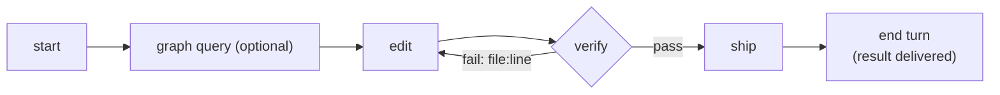

<div align="center">

# ⚡ MonoFlow

### Make your monorepo usable by coding agents.

One Go binary that gives Claude Code, Cursor, opencode and other agents a **map** of your repo,<br>
**feedback that covers exactly what CI covers**, an **isolated place** to work, and a **safe path** to ship.

[](https://github.com/M0xoo/monoflow/actions/workflows/ci.yml)
[](https://go.dev)
[](./LICENSE)
[](#-language-support)

[**Website**](https://m0xoo.github.io/monoflow/) •
[Quickstart](#-quickstart) •
[The agent path](#-the-agent-path) •
[What you get](#-what-you-get) •
[Benchmarks](#-benchmarks) •
[Commands](#-commands)

</div>

---

## 💡 Why MonoFlow?

Most monorepos are set up for humans. When an agent does the coding, the usual workflow wastes its time, its tokens and your review hours.

| 🐢 Without MonoFlow, an agent… | ⚡ With MonoFlow, it… |
| :--- | :--- |
| greps the whole tree to guess what uses a package | asks `graph query <dir>`: every importer, in every module |
| guesses which tests to run, or runs everything | runs `verify`: every package the change can affect, nothing else |
| reads pages of colored logs | gets each break as `file:line`, with the failing line shown |
| pushes, then finds out CI is red | can only push a commit that passed local CI on that exact commit |
| polls `gh run watch`, spending tokens while it waits | ends its turn; results are **delivered** to it |
| edits the same checkout as you and every other agent | works in its own worktree and branch |

---

## 🚀 Quickstart

```bash
# 1. Build (Go 1.22+)
git clone https://github.com/M0xoo/monoflow.git
cd monoflow && make build

# 2. Install into your repository
cd /path/to/your-repo
/path/to/monoflow/install.sh

# 3. (optional) GitHub Actions: affected-only CI that reuses local results
./bin/monoflow init --setup-gh-actions
```

`monoflow init` discovers your packages (Go modules, pnpm/npm/yarn workspaces with Nx or Turborepo, Cargo, Python, plus `packages/`, `apps/`, `services/`… directories) and writes what your agent needs:

| File | Purpose |
| :--- | :--- |
| `.agents/monoflow.config.json` | Packages, their commands and the dependency graph |
| `AGENTS.md` · `.agents/skills/monoflow/` | A 1.4 KB guide, placed first in `AGENTS.md`; your own guide follows it |
| `.claude/settings.json` · `.opencode/plugin/` | Hooks that deliver results to the agent and redirect raw commands |
| `.agents/task.json` · `.agents/quarantine.json` | Task boundaries; flaky tests kept out of the loop |

---

## 🔁 The agent path

Three commands take a change to a PR:

```bash
monoflow start fix-tax-rounding     # worktree + branch agent/fix-tax-rounding; cd into the printed path
# ... edit ...
monoflow verify                     # build + lint + test every package the change can affect
monoflow ship -m "fix: tax rounding" # commit, local CI on that commit, push, open the PR
```



Output is short plain text, because an agent reads it rather than parsing it. Every command takes `--json` (or `MONOFLOW_FORMAT=json`) for scripts. A failing `verify`:

```
FAIL 0/1 packages passed in 1.0s
scope: all 1 packages (every package depends on your change)
failed: core
core/core_test.go:7 [TestAdd] want 3
       6| 	if Add(1, 2) != 3 {
  >    7| 		t.Fatal("want 3")
       8| 	}
next: fix the errors listed (file:line), then monoflow verify
```

---

## 🧰 What you get

### 1. 🗺️ A map of the repo

```bash
monoflow graph query packages/core        # dependencies, dependents, and (Go) every package importing it
monoflow graph impact packages/core/x.go  # which packages a change to this file affects
```

`graph query` works on a package name or any directory inside one. For Go it lists the importing packages across all modules in about a second, which agents otherwise approximate with a repo-wide grep.

### 2. ⚡ `verify`: the CI for this change, locally

- **Scope.** The changed packages and everything that depends on them, which is what CI runs for this change. The output says how many packages were left out and why. For Go, only the packages whose code or tests import a changed package are run, and gofmt checks only the changed files.
- **Staged.** Changed packages run first. Their dependents run only once those pass, so a broken edit fails fast.
- **Uses your repo's own tools.** It runs your package scripts (`test`, `test:lib`, `typecheck`, `lint`…). Upstream builds go through Nx or Turborepo in one call when the repo uses them.
- **Cached** by content. A package whose inputs didn't change is not re-run.
- **Pre-existing failures** (already red on the base branch) are reported but don't block. `--strict` makes them block.
- **Flaky tests.** A timing-like failure is retried once alone and reported as flaky. Deterministic failures are not retried.
- **Runs in the background.** In a worktree from `start`, `verify` starts as soon as the agent's edits settle. When the agent asks, the result for those exact files is often already there.
- **Snapshots.** `verify -u` rewrites mismatched vitest/jest snapshots when the new values are intended.

### 3. 🚢 `ship`: nothing red reaches the remote

`ship` commits and returns right away. In the background, MonoFlow runs local CI on that exact commit, in a clean checkout of it. Only when that is green does it push and open the PR. If it fails, the agent gets `SHIP_FAILED` or `OUTER_LOOP_REGRESSION` with the errors.

- Direct pushes to `main`/`master` are refused, and raw `git push`/`git commit` are redirected through MonoFlow by Git hooks and harness hooks.
- Forgot `start` and edited on `main`? `ship` moves the work onto its own branch and worktree first.
- With `init --setup-gh-actions`, remote CI runs only affected packages. It can take a fast path for commits that carry a local proof receipt.

### 4. 📬 No polling

MonoFlow's hooks for Claude Code and opencode inject new events (local CI, remote CI, PRs) into the agent's context after its tool calls. When the agent ends its turn while a result is pending, the Stop hook waits for it and resumes the agent if something needs action. Other harnesses can run `monoflow events wait <sha>` as a background task.

When CI is red, `monoflow ci health` reports when each check started failing, the breaking commit range and flaky checks, in one call instead of dozens of `gh run view` reads.

### 5. 🧪 Isolation and undo

```bash
monoflow start agent-42 --packages=billing   # sparse worktree: billing + what it depends on
monoflow checkpoint save "try new rounding"  # snapshot outside Git history
monoflow checkpoint revert
monoflow worktree finish agent-42
```

Worktrees for pnpm repos get a real offline `pnpm install`, so test runners like Vite see real paths. When two agents add different functions to the same file, `worktree sync` merges at the AST level (Go, TS/JS, Python).

### 6. 🛡️ Guardrails

| Guardrail | Command | What it stops |
| :--- | :--- | :--- |
| **Test integrity** | `guard check` (also on `commit`) | Deleted, commented-out or hollow assertions |
| **Secret scan** | `guard check` (also on `commit`) | API keys and private keys in diffs |
| **Task boundaries** | `task check` | Edits outside `allowed_paths`, or to `read_only_paths` |
| **Proof of work** | `task prove <id>` → `verify --proof=<id>` | "It works on my machine" PRs |
| **Risk scoring** | `review risk` · `review audit` | Risky changes without a human; PR text that doesn't match the diff |
| **Backpressure** | `review throttle` | More PRs than reviewers can handle |
| **Circuit breaker** | automatic in `verify` | An agent failing the same targets over and over (snapshots its work) |

---

## 📊 Benchmarks

A/B runs in which the same agent does the same task with MonoFlow and with plain git. The harness and every number are in [`e2e/bench/`](./e2e/bench/RESULTS.md); here is the short version, losses included:

| Repo | Task | Result |
| :--- | :--- | :--- |
| opentelemetry-go (29 Go modules) | a change caught only by another module's tests | MonoFlow faster (median 101 s vs 130 s) and steadier (90–112 s vs 109–338 s); tokens about equal (median 60k vs 55k) |
| trpc (pnpm + Turborepo) | 400 → 422 for validation errors, across packages | **plain git + Turbo ahead** on time (237–345 s vs 377–586 s) and similar on tokens |

Every MonoFlow push in these runs was gated on local CI; plain pushes were not. Speculative verify and the Nx (TanStack Query) comparison have not been measured yet.

---

## 🌐 Language support

| Language | Discovered from | Checks |
| :--- | :--- | :--- |
| **Go** | `go.mod` (multi-module, `go.work`) | `go build`, `go vet`, `go test` (package-scoped), gofmt |
| **TypeScript / JS** | pnpm/npm/yarn workspaces, Nx, Turborepo | the package's own `test`/`typecheck`/`lint` scripts; vitest and jest failures parsed |
| **Rust** | Cargo workspaces | `cargo check -p`, `cargo test -p` |
| **Python** | `pyproject.toml`, `setup.py` | `ruff check`, `pytest` |
| **Protobuf** | a `contracts/` directory | a package in the graph, for impact across languages (no checks of its own) |

---

## 📖 Commands

| Area | Commands |
| :--- | :--- |
| 🔁 **Agent path** | `start <id>` · `verify` · `ship -m "<msg>"` |
| 🏁 **Setup** | `init [--setup-gh-actions]` · `clone <url> --packages=…` |
| 🗺️ **Understand** | `graph query <pkg\|dir>` · `graph impact <file>` · `graph affected` |
| ⚡ **Inner loop** | `verify [--package=<p>\|--all\|-u\|--strict]` · `checkpoint save\|revert\|list` · `cache status\|clean\|serve` · `quarantine list\|add` |
| 🧪 **Isolation** | `worktree create\|list\|sync\|finish\|gc` · `subset set\|add\|remove\|check` |
| 🌿 **Git** | `commit -m` · `branch` · `sync` · `push` |
| 🚢 **Ship** | `pr create\|status\|test\|local\|review\|merge` · `outer status\|wait` · `queue spec` · `ci check` |
| 📬 **Events & CI** | `events unread\|wait\|ack` · `ci health [--check=<name>] [--logs]` |
| 🛡️ **Guardrails** | `guard check` · `task check\|prove\|slice` · `review risk\|audit\|throttle` |
| 📦 **Release** | `version list\|bump\|apply\|check` · `deliver` |

`monoflow help` prints the short list; `monoflow help <command>` shows one command's flags, and `monoflow help --all` shows everything.

---

## 🤝 Contributing

```bash
make test    # unit + integration tests
make build   # bin/monoflow
make e2e     # end-to-end multi-agent scenario
```

---

## 📄 License

Licensed under the [MIT License](./LICENSE).
